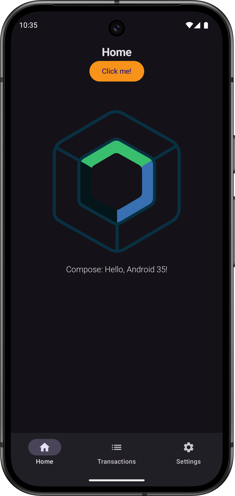

# Hodl

 <!-- x-release-please-version -->

Crypto portfolio tracking app for Android, iOS and Desktop.



## Project Structure

This KMP project utilizes a modular architecture powered by the JetBrains Kotlin Toolchain CLI, combining Clean Architecture principles and package-by-feature structure for maintainability and scalability.

```
Hodl/
├── project.yaml                         // Root project definition
├── kotlin                               // Standalone Kotlin Toolchain CLI wrapper
├── libs.versions.toml                   // Centralized version catalog
├── scripts/
│   ├── ktfmt.sh                         // Deterministic Kotlin formatter (ktfmt)
│   └── sync-versions.sh                 // Version code & name synchronization script
├── shared/                              // Code shared across KMP applications
│   ├── module.yaml                      // Declarative module definition (kmp/lib)
│   ├── composeResources/                // Shared Compose multiplatform resources
│   ├── schemas/                         // Room database schema JSON exports
│   ├── src/                             // Common Kotlin code for all targets
│   │   └── com/digrec/hodl/
│   │       ├── HodlApp.kt               // Entry point for shared UI
│   │       ├── core/                    // Core business logic, domain models, Room DB
│   │       ├── di/                      // Dependency injection (Koin)
│   │       ├── feature/                 // Feature modules (currency, home, settings, transactions)
│   │       ├── navigation/              // Compose navigation logic & destinations
│   │       └── ui/                      // Theme, color palette, typography
│   ├── src@android/                     // Android-specific actual implementations
│   ├── src@jvm/                         // Desktop JVM-specific actual implementations
│   ├── src@ios/                         // iOS-specific actual implementations
│   ├── test/                            // Common unit testing suite
│   └── test@jvm/                        // JVM & Room DB migration tests
├── androidApp/                          // Android application module (android/app)
│   ├── module.yaml
│   ├── res/
│   └── src/
├── desktopApp/                          // Desktop application module (jvm/app)
│   ├── module.yaml
│   └── src/
└── iosApp/                              // iOS application module (ios/app)
    ├── module.yaml
    └── src/                             // Swift entry point, SwiftUI ContentView, Info.plist
```

## Tech Stack & Tooling

| Component | Technology | Reference |
| :--- | :--- | :--- |
| **Language & SDK** | Kotlin (JDK 21 toolchain), Android SDK 37 | [`libs.versions.toml`](libs.versions.toml) |
| **Build System** | JetBrains Kotlin Toolchain CLI (`kotlin` / Amper) | [`project.yaml`](project.yaml) |
| **UI Framework** | Compose Multiplatform | [`libs.versions.toml`](libs.versions.toml) |
| **Dependency Injection** | Koin | [`libs.versions.toml`](libs.versions.toml) |
| **Database** | Room KMP (`sqlite-bundled`) | [`libs.versions.toml`](libs.versions.toml) |
| **Unit Testing** | Kotlin Test, Coroutines Test, Koin Test, Turbine | [`libs.versions.toml`](libs.versions.toml) |
| **Logging** | Kermit | [`libs.versions.toml`](libs.versions.toml) |
| **Code Formatter** | ktfmt (`kotlinLangStyle`, 4-space; `brew install ktfmt`) | [`scripts/ktfmt.sh`](scripts/ktfmt.sh) |

> [!NOTE]
> All specific library versions are defined centrally in root [`libs.versions.toml`](libs.versions.toml).

### AI Coding Agents & Guidelines

AI Agents working on this codebase should refer to [`AGENTS.md`](AGENTS.md) for architectural conventions, Compose `@Preview` rules, Conventional Commits format, and build verification instructions.

### Versioning

This project uses [Release Please](https://github.com/googleapis/release-please) for automated version management and changelog generation.

Release Please:
* Automatically determines the next semantic version based on conventional commits
* Creates release PRs with version bumps and updated changelog
* Updates version badges and references throughout the codebase

To make a release:
1. Ensure all commits follow [Conventional Commits](https://www.conventionalcommits.org/) format with a headline and detailed body (e.g., `feat:`, `fix:`, `docs:`, etc.)
2. The Release Please GitHub Action will automatically create a release PR when new conventional commits are pushed to the main branch
3. Once the release PR is merged, a new version will be published and tags will be created

## How to Run & Verify

Use the standalone Kotlin Toolchain CLI (`./kotlin`) for building, testing, and running:

### Compile & Build All Modules
```shell
./kotlin build
```

### Running Unit Tests
Execute the unit testing suite across Desktop JVM, Android, and iOS Simulator:
```shell
./kotlin test
```

### Code Formatting
Check or apply `ktfmt` (`kotlinLangStyle`, 4-space indent) across all Kotlin sources:
```shell
./scripts/ktfmt.sh --dry-run   # Verify formatting without modifying files
./scripts/ktfmt.sh             # Format all Kotlin files in-place
```
Uses a locally installed `ktfmt` CLI (`brew install ktfmt`) when available, or automatically falls back to downloading `.kotlin/tooling/ktfmt-0.54.jar` via Java 21.

### Running Applications

**Desktop App** (with Compose Hot Reload):
```shell
./kotlin run -m desktopApp
```

**Android App** (on connected emulator/device):
```shell
./kotlin run -m androidApp
```

**iOS App** (on simulator):
```shell
./kotlin run -m iosApp -p iosSimulatorArm64
```

### Compose Hot Reload & AI Agent Tooling (MCP)
The Kotlin Toolchain CLI includes a built-in MCP server for real-time Compose UI inspection:
```shell
./kotlin compose-hot-reload-mcp-server
```
Connecting an MCP client (such as Claude Desktop, Cursor, or AI coding agents) enables real-time visual UI inspection (`take_screenshot`), semantic tree querying (`get_semantic_tree`), user input simulation (`click`, `type_text`, `scroll`), and automated hot-reload verification directly during development. See [`.mcp.json`](.mcp.json) and [`.agents/README.md`](.agents/README.md) for client setup.
